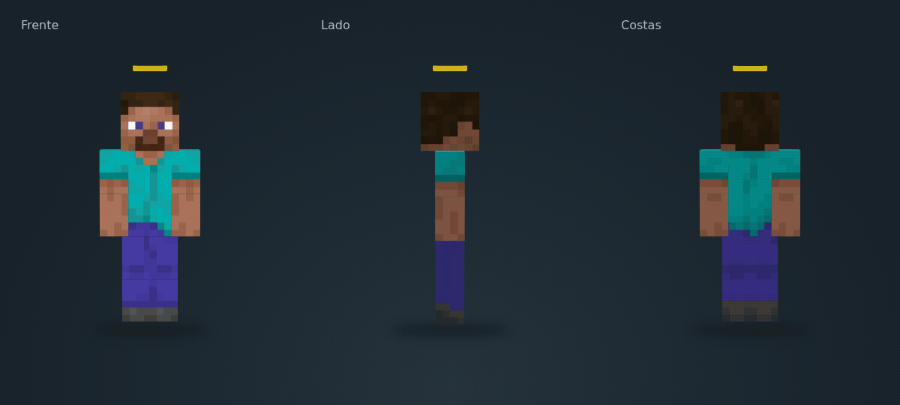

# Anjo e Hearts — implementados na versão 2.4.0



O preview usa as transformações amostradas da animação Java implementada,
exportadas por `AnimationPreviewExport`. As asas usam exatamente a hierarquia,
as faces e a textura convertidas para o renderer do mod. O Steve é ilustrativo;
o mod usa a skin do jogador. Esta renderização externa não é uma captura do
Minecraft; iluminação, ordenação da transparência e detalhes do Bendy podem
ter diferenças no jogo, que não foi aberto.

## Anjo

- Mantém os 2,2 s, o movimento flutuante da cabeça e a auréola existente.
- Os braços avançam, os cotovelos dobram e as mãos quase se encontram à frente
  da parte superior do peito, seguindo a imagem de referência.
- A transparência das asas entra gradualmente; a abertura começa após o alcance
  dos braços e as extremidades acompanham com 100 ms de atraso.
- As asas são renderizadas como parte do torso: recebem posição, rotação e
  escala do `body` do jogador, além das transformações gerais do renderer.
- A montagem mantém uma folga atrás do corpo, verificada ao longo da animação.

## Modelo original

Arquivo: `reference/asa.cpmproject`, SHA-256
`0677318f9cf07522f86cd89928fec6b12c2ad597d61ae2922e30d7a8734b95de`.
A descrição original é **Little Angel — Made by eosuki**.

O conversor preserva 19 nós, 13 cubos, 78 faces, posições, rotações, escalas e
recortes UV. `angel_wings.png` é uma cópia exata de `skin.png` do projeto
original (2100 × 1500). A geometria não foi substituída ou redimensionada.
Apenas a montagem nas costas e as rotações animadas foram adicionadas.

## Hearts

A pose aprovada foi aplicada com duração de 1,85 s: mãos juntas à frente,
perna direita elevada para trás e um pouco para o lado, joelho dobrado e
perna esquerda apoiada. Os corações e controles existentes permanecem.

## Reproduzir o preview sem abrir Minecraft

```sh
python3 tools/convert_angel_wings.py
bash gradlew exportAnimationPreview --offline --console=plain
node tools/render_angel_preview.cjs
```

O script inicia e fecha um servidor HTTP local e um Chrome headless para
capturar os quadros. `preview.html` permite observar o movimento continuamente
quando aberto por um servidor HTTP na pasta do projeto. Use
`preview.html?reaction=hearts` para inspecionar a pose implementada de Hearts.
O GIF e o MP4 são gerados a partir dos quadros exportados, a 25 FPS.
