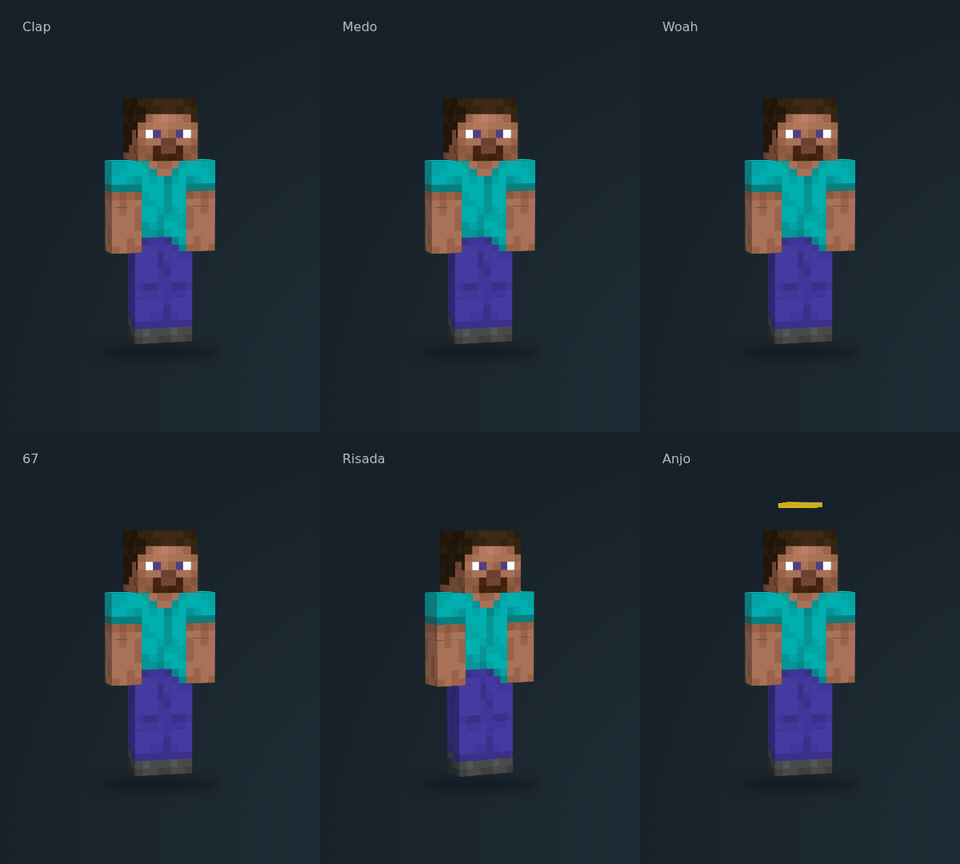

# Gestos aperfeiçoados — versão 2.5.1



Os quadros usam as transformações exportadas das animações Java reais. Steve
é ilustrativo; o mod usa a skin do jogador. Esta é uma renderização externa,
sem iniciar Minecraft, e não substitui a conferência visual dentro do jogo.
O GIF é silencioso; os sete contatos de Clap foram comparados com os tempos
da gravação original, preservada no JAR.

- Clap: preparação de 200 ms, cotovelos dobrados e mãos que se encontram em
  cada uma das sete palmas. Retorno suave; duração total de 2,3 s.
- Medo: mãos elevadas e sobressaltos menores e irregulares nos ombros.
- Woah: reação levemente defasada entre os braços, com tronco estável.
- 67: alternância feita principalmente pelos cotovelos, sem o movimento amplo
  e espelhado dos braços inteiros.
- Risada: rosto livre, mãos no abdômen em alturas diferentes e impulsos curtos
  e assimétricos no corpo, ombros e cabeça, seguindo as referências enviadas.
- Anjo: tronco estável, com a pose das mãos, a auréola e as asas preservadas.

Apenas a risada anima o tronco. As outras poses mantêm o tronco e a roupa
estáveis, com limpeza entre emotes, jogadores e preview. Braços, pernas,
cabeça, GUI e arquivos de mídia continuam disponíveis. Todos os gestos
continuam finitos, exceto o loop já existente de Scuba.

## Reproduzir a captura sem abrir Minecraft

```sh
bash gradlew exportAnimationPreview --offline --console=plain
node tools/render_gesture_polish.cjs
```

O script usa o visualizador existente e captura cada gesto a 25 FPS. Cada
painel repete sua animação com uma pequena pausa em repouso. O exportador usa
o mesmo player de animação filtrado que o jogo, além dos dados de pose. O Anjo
mantém as oscilações da cabeça e as asas, mas o tronco é estável, assim como
nos demais emotes, com exceção da risada. Esta captura externa não testa os
mixins ou a renderização real do Bendy dentro do Minecraft.
