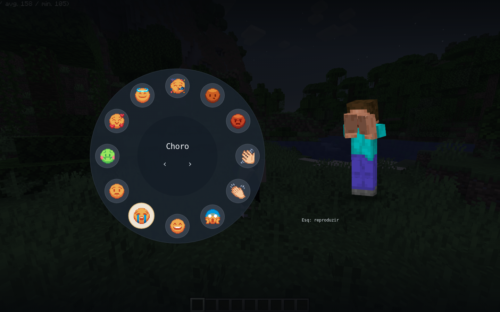
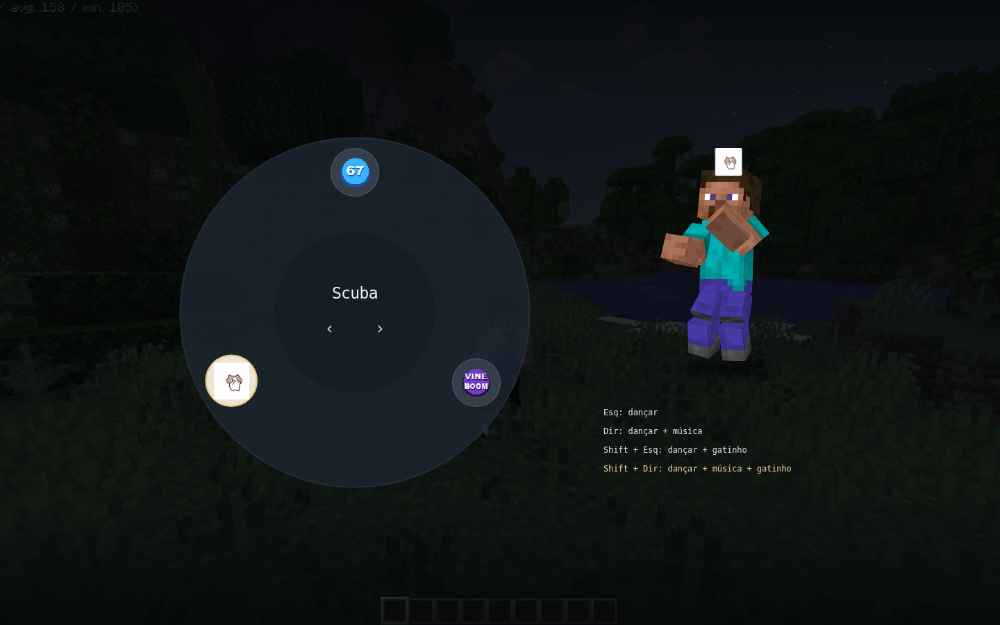

# Proposta de aparência — aprovada e implementada

Esta proposta substitui a primeira maquete e foi aprovada pelo usuário em
04/11/2026. O layout foi integrado ao mod na versão **2.3.0**. As imagens e o
HTML desta pasta continuam sendo maquetes de referência, e não capturas do jogo.

## Distribuição

- **Esquerda:** somente a roda, seus emotes, o nome da seleção no centro e as
  duas setas de navegação. Mantém a ordem e as duas páginas existentes.
- **Direita:** o jogador realizando o emote selecionado, sem card, cabeçalho,
  descrição ou moldura. A seleção por hover troca o preview localmente.
- **Abaixo do jogador:** somente as combinações disponíveis para aquela seleção.

Não haverá slogan, contagem de emotes, duração, selo de loop, texto explicativo,
ícones decorativos, dicas genéricas ou rodapé de atalhos. Os ícones originais
dos emotes permanecem na roda. A seleção conserva um contorno discreto na cor
já usada pelo mod.

O avatar Steve das imagens é ilustrativo. A implementação usa a skin do
próprio jogador e os mesmos dados de animação do emote. O hover não reproduz
áudio nem envia uma reação ao servidor. O preview do jogador
continua ao lado da roda; em janelas menores, o conjunto se ajustará à área útil.

## Navegação e combinações

A roda conserva clique esquerdo, o clique direito de Hi/Bye e Scuba, teclado,
scroll e fechamento por Z/Esc. As teclas de fechamento e navegação continuam
funcionando, sem uma legenda permanente na interface.

| Scuba | Resultado |
|---|---|
| Clique esquerdo | Dança |
| Clique direito | Dança e música |
| Shift + clique esquerdo | Dança e gatinho |
| Shift + clique direito | Dança, música e gatinho |

O gatinho fica desativado por padrão. O Shift usado na seleção fica ignorado,
inclusive sua pose de agachamento, até ser solto; um novo agachamento cancela
o emote. Caminhar não cancela.

## Movimento e custo

- Abertura: escala de 78% a 100% com fade, 210 ms, ease-out cubic.
- Hover: ampliação de 10%, ida e volta em 150 ms, reversível sem saltos.
- Páginas: cross-fade de 180 ms e escala de 98,5% a 100%, sem quadro vazio.
- Cliques permanecem disponíveis durante a animação; suas coordenadas acompanham
  a escala visual. A navegação de volta usa a mesma transição.

A versão 2.3.0 implementa as animações, o layout aprovado e o preview lateral.
O desenho agrupa os círculos em lotes e reaproveita seus contornos. Os 34
testes passaram, incluindo reversões rápidas, continuidade das páginas,
limites da janela, alinhamento dos cliques/recorte e isolamento do preview.
Minecraft não foi aberto; a renderização e o FPS dentro do jogo não foram
avaliados nesta verificação.

O arquivo `proposal.html` permite inspecionar esta maquete localmente. Não é
uma captura do jogo com a reformulação instalada.
