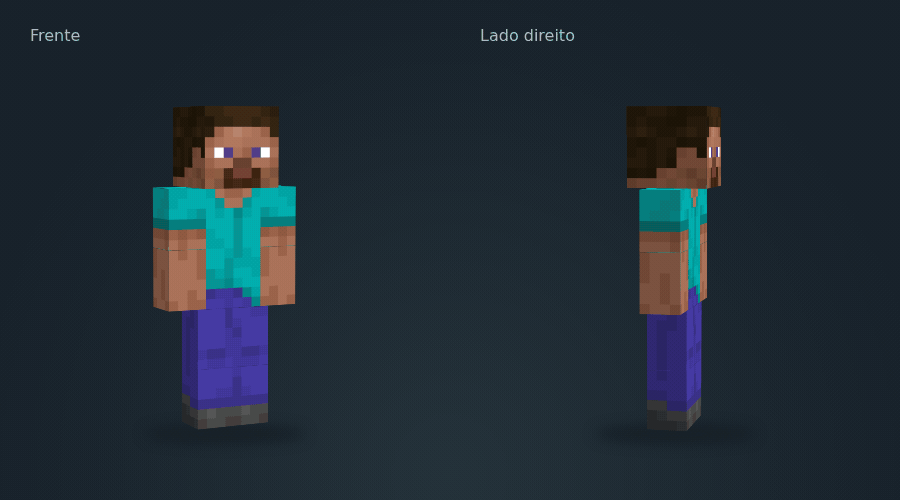

# Hearts — pose aprovada e implementada

Pose aprovada pelo usuário e implementada na versão 2.4.0.
O avatar Steve é ilustrativo. A implementação usará a skin do jogador e a
biblioteca de dobras já incluída no mod.

- Mãos se aproximam e ficam unidas à frente do peito, com os cotovelos dobrados.
- A perna direita sobe para trás, afastada um pouco para o lado, com dobra no
  joelho. A perna esquerda permanece apoiada.
- O tronco inclina discretamente para a perna de apoio e a cabeça acompanha
  o gesto. A pose entra e sai suavemente, com respiração discreta durante a pausa.
- A proposta preserva a duração de 1,85 s e os corações existentes.

O preview mostra a mesma pose em duas vistas simultâneas: frente e lado direito.
Há 350 ms em repouso entre as repetições para facilitar a comparação.

Abra `preview.html` para ver a versão contínua. Este é um estudo da pose fora
do Minecraft, não uma captura do jogo nem uma garantia da renderização final.
